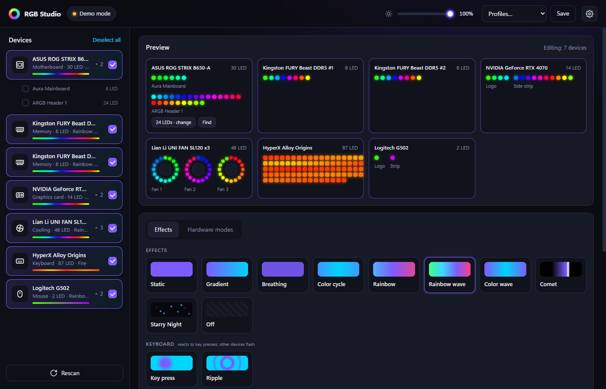
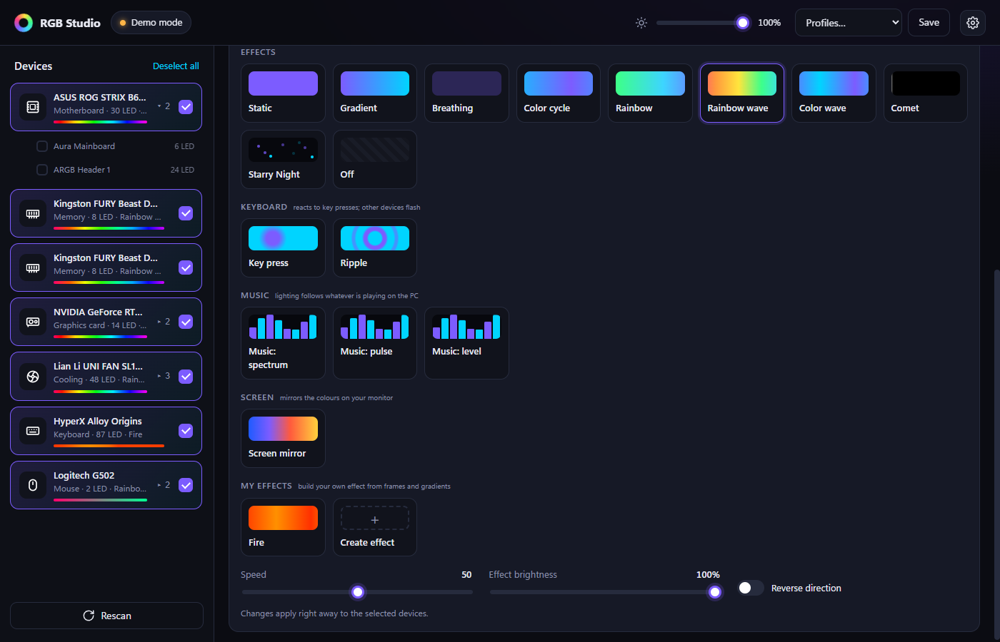
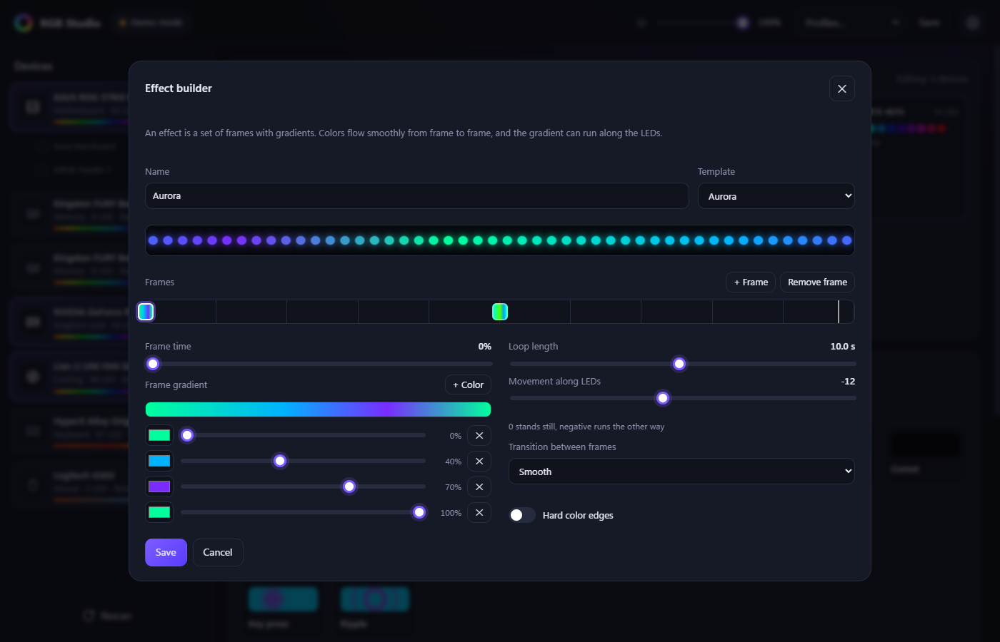
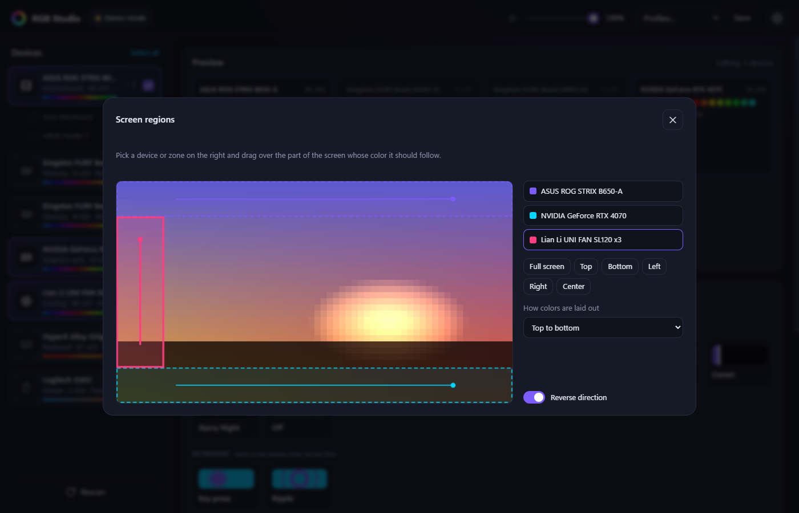

<div align="center">

# RGB Studio

**Simple, friendly RGB lighting control for Windows, built on [OpenRGB](https://openrgb.org).**<br>
**Простое и понятное управление RGB-подсветкой для Windows на базе [OpenRGB](https://openrgb.org).**

[](LICENSE)

[](https://openrgb.org)
[](https://claude.com/claude-code)


[**⬇ Download / Скачать**](https://github.com/AuF22/rgb-studio/releases/latest) · [English](#english) · [Русский](#русский)



</div>

> [!NOTE]
> **Built on OpenRGB.** RGB Studio is an independent interface on top of the [OpenRGB](https://openrgb.org) engine,
> which ships inside the app. OpenRGB provides support for hundreds of devices. RGB Studio is not affiliated with the OpenRGB project.
>
> **Made by Claude.** This app was designed and written by [Claude](https://claude.com/claude-code), Anthropic's AI,
> in Claude Code at the request of [@AuF22](https://github.com/AuF22).
>
> **На базе OpenRGB. Сделано Claude.** RGB Studio — независимый интерфейс поверх встроенного движка OpenRGB.
> Приложение спроектировал и написал Claude (ИИ от Anthropic) по просьбе [@AuF22](https://github.com/AuF22).

---

<a id="english"></a>

## English

### What it is

RGB Studio lets you control all the RGB in your PC from one clean window: motherboard, memory, graphics card,
keyboard, mouse, ARGB fans and strips. Under the hood it runs the open-source [OpenRGB](https://openrgb.org)
engine invisibly, so there is nothing else to install or configure. The interface is available in **English and Russian**.

### Features

- **All your RGB in one place.** Anything [OpenRGB supports](https://openrgb.org/devices.html) works.
- **Live preview** of every LED, with fans drawn as rings and keyboards as a key grid.
- **Every device and every zone separately.** Each ARGB header, GPU zone or RAM stick can have its own effect.
- **Effects:** static, gradient, breathing, color cycle, rainbow, rainbow wave, color wave, comet,
  **Starry Night** (like Armoury Crate's), off.
- **Create your own effects.** A visual builder with keyframes, gradients and movement along the LEDs, plus templates:
  police lights, sunset, fire, aurora, heartbeat.
- **Keyboard:** keys light up as you press them, or send a ripple across the keyboard.
- **Music:** spectrum, beat pulse and level meter, driven by whatever is playing on the PC.
- **Screen mirroring (ambilight):** each device or zone follows its own part of the screen, set up in a visual editor.
- **ARGB LED count finder.** A slider lights exactly N LEDs, so you can see where a fan or strip ends.
- **Hardware modes** stored in the device itself, which keep running when the app is closed.
- **Profiles**, global brightness, start with Windows into the tray, and your lighting comes back after a restart.

| Effects | Effect builder |
|---|---|
|  |  |

| Screen regions |
|---|
|  |

<sub>Screenshots use the built-in demo mode with virtual devices. The screen editor shows a painted picture.</sub>

### Installation

**Installer (recommended)**

1. Open [Releases](https://github.com/AuF22/rgb-studio/releases/latest) and download **`RGB-Studio-Setup-x.y.z.exe`**.
2. Run it. If Windows SmartScreen says *"Windows protected your PC"*, click **More info → Run anyway**.
   The app is not code-signed, which is normal for small open-source projects.
3. Choose the options:
   - **Create a desktop shortcut.**
   - **Start with Windows.** The app starts in the tray at logon, with no UAC prompt, and restores your lighting.
   - **Install the PawnIO driver.** Needed to control **RAM** and some **motherboards**. Recommended.
4. Finish, launch RGB Studio, and confirm the administrator prompt.

**Portable**

Download **`RGB-Studio-x.y.z-win64-portable.zip`**, unpack it anywhere and run `RGB Studio.exe`.
Install PawnIO from the app if your RAM isn't detected (yellow bar → *Install driver*).

**Requirements:** Windows 10 or 11, 64-bit. Nothing else: OpenRGB and the Visual C++ runtime are included.

**Uninstall:** *Settings → Apps → RGB Studio → Uninstall*. This also removes the autostart task.
Your settings stay in `%APPDATA%\RGBStudio`. Delete that folder for a clean removal.

### Getting started

1. **Pick devices** on the left. Click **▸** next to a device to control its zones separately.
   Ctrl+click selects a single item.
2. **Choose an effect** and adjust colors, speed and brightness. Changes apply instantly.
3. **ARGB fans or strips dark?** ARGB LEDs can't report how many there are, not to RGB Studio and not to any other app.
   Under the header in the preview, click **Find** and move the slider until the red LED sits on the last one.
4. **Make your own effect:** *My effects → Create effect*. Pick a template or start blank, add frames, set gradients,
   and save. Double-click a custom effect to edit it.
5. **Screen mirroring:** pick devices, choose *Screen mirror*, then drag over the part of the screen each device should follow.
6. **Profiles:** set up the lighting you like and click **Save** at the top. Load it from the *Profiles* menu.
7. **Language:** *Settings → Language → English / Русский*.

Closing the window keeps the lighting running in the tray. To quit, right-click the tray icon → **Exit**.

### Troubleshooting

| Problem | What to do |
|---|---|
| RAM or motherboard not listed | Run as administrator (the app asks for it) and install PawnIO: yellow bar → *Install driver*, then restart the PC if asked. |
| A device is missing | RGB Studio supports what OpenRGB supports. See the [device list](https://openrgb.org/devices.html). Gamepads using the Xbox 360 protocol, for example, have no lighting control. |
| Fans/strip on an ARGB header stay dark | Set the LED count with **Find** (see above). |
| The window shows "an old copy is running" | Exit RGB Studio from the tray and start it again. |

### Privacy

Everything runs locally. The interface is served on `127.0.0.1` only. The keyboard effects use a keyboard hook only while
such an effect is on, and keep just the names of recently pressed keys in memory for about two seconds. Audio and screen
are analysed on the fly. Nothing is recorded, saved or sent anywhere.

### Build from source

You need Windows 10/11 x64 and Python 3.12 or newer (developed on 3.14).
[Inno Setup 6](https://jrsoftware.org/isinfo.php) is only needed for the installer.

```bash
py -m pip install -r requirements.txt
```

```bash
py tools/fetch_engine.py
```

```bash
py app.py
```

`fetch_engine.py` downloads OpenRGB 1.1 and the PawnIO installer from their official releases and verifies SHA-256.
Useful flags for `app.py`: `--demo` (virtual devices), `--minimized` (tray only), `--no-window` (server only on http://127.0.0.1:6750).

Build the exe, the portable zip and the installer into `release/`:

```bash
powershell -ExecutionPolicy Bypass -File tools\build.ps1
```

### How it works

```
 UI (HTML/JS in an Edge app window)  ──HTTP, localhost──▶  RGB Studio (Python): effects @30 fps,
                                     ◀──live LED frames──  audio, screen, keys, profiles
                                                                   │ OpenRGB SDK, TCP 6742
                                                                   ▼
                                                     OpenRGB 1.1 (bundled, headless) ──▶ devices
```

| Path | Purpose |
|---|---|
| `app.py` | Flask server and REST API, window, tray, autostart, single instance |
| `openrgb_runtime.py` | Starts the bundled OpenRGB headless and ties it to the app; admin and PawnIO helpers |
| `rgb_backend.py` | Devices over the OpenRGB SDK, plus virtual demo devices |
| `effects.py` | Effect engine: per-device and per-zone effects, custom effects |
| `sources.py` | Live inputs: WASAPI loopback audio, screen capture, keyboard hook |
| `lang.py`, `static/i18n.js` | English and Russian translations |
| `static/` | The interface (plain HTML, CSS and JS) |
| `installer/` | Inno Setup script |
| `tools/` | Engine download, icon, screenshots, build |

### Credits

- **[OpenRGB](https://openrgb.org)** by Adam Honse and contributors (GPL-2.0), the engine behind all device support.
  RGB Studio ships an unmodified build and talks to it over the OpenRGB SDK protocol.
  Source: <https://codeberg.org/OpenRGB/OpenRGB>.
- **[PawnIO](https://pawnio.eu)** by namazso, the signed driver OpenRGB uses for SMBus access.
- Python libraries: Flask, openrgb-python, NumPy, SoundCard, MSS, pystray, Pillow.
- **Designed and written by [Claude](https://claude.com/claude-code)** (Anthropic) in Claude Code.

### License

[GNU General Public License v2.0](LICENSE), the same license as OpenRGB.

---

<a id="русский"></a>

## Русский

### Что это

RGB Studio позволяет управлять всей подсветкой компьютера из одного понятного окна: материнской платой, памятью,
видеокартой, клавиатурой, мышью, ARGB-вентиляторами и лентами. Внутри незаметно работает открытый движок
[OpenRGB](https://openrgb.org), поэтому ничего дополнительно устанавливать и настраивать не нужно.
Интерфейс есть на **русском и английском**.

### Возможности

- **Вся подсветка в одном месте.** Работает всё, что [поддерживает OpenRGB](https://openrgb.org/devices.html).
- **Живой предпросмотр** каждого светодиода. Вентиляторы нарисованы кольцами, клавиатура сеткой клавиш.
- **Каждое устройство и каждая зона отдельно:** свой эффект на каждом ARGB-разъёме, зоне видеокарты, планке памяти.
- **Эффекты:** статичный, градиент, дыхание, смена цветов, радуга, радужная волна, цветная волна, комета,
  **«Звёздная ночь»** (как в Armoury Crate), выключить.
- **Свои эффекты.** Наглядный конструктор с кадрами, градиентами и движением по светодиодам. Есть шаблоны:
  полицейские огни, закат, огонь, северное сияние, сердцебиение.
- **Клавиатура:** клавиши загораются под пальцами или пускают волну по клавиатуре.
- **Музыка:** спектр, пульс по битам и индикатор уровня. Реагирует на звук, который играет на компьютере.
- **Повтор экрана (ambilight):** каждое устройство или зона повторяет свою часть экрана, области задаются в редакторе.
- **Подбор числа светодиодов ARGB:** ползунок зажигает ровно N светодиодов, и видно, где кончается вентилятор или лента.
- **Встроенные режимы** хранятся в самом устройстве и работают даже при закрытом приложении.
- **Профили**, общая яркость, автозапуск с Windows в трей. Подсветка восстанавливается после перезапуска.

### Установка

**Установщик (рекомендуется)**

1. Откройте раздел [Releases](https://github.com/AuF22/rgb-studio/releases/latest) и скачайте **`RGB-Studio-Setup-x.y.z.exe`**.
2. Запустите. Если Windows SmartScreen пишет *«Система Windows защитила ваш компьютер»*, нажмите
   **Подробнее → Выполнить в любом случае**. У приложения нет цифровой подписи, для небольших открытых проектов это обычно.
3. Выберите параметры:
   - **Создать значок на рабочем столе.**
   - **Запускать вместе с Windows.** Приложение стартует в трей при входе без запроса UAC и восстанавливает подсветку.
   - **Установить драйвер PawnIO.** Нужен для **оперативной памяти** и части **материнских плат**. Рекомендуется.
4. Завершите установку, запустите RGB Studio и подтвердите запрос прав администратора.

**Портативная версия**

Скачайте **`RGB-Studio-x.y.z-win64-portable.zip`**, распакуйте в любую папку и запустите `RGB Studio.exe`.
Если память не определилась, установите PawnIO прямо из приложения: жёлтая плашка → *Установить драйвер*.

**Требования:** Windows 10 или 11, 64-бит. Больше ничего не нужно: OpenRGB и библиотеки Visual C++ уже внутри.

**Удаление:** *Параметры → Приложения → RGB Studio → Удалить*. Автозапуск тоже снимается.
Настройки остаются в `%APPDATA%\RGBStudio`. Удалите эту папку, если хотите стереть всё.

### С чего начать

1. **Выберите устройства** слева. Кнопка **▸** рядом с устройством раскрывает его зоны для отдельной настройки.
   Ctrl+клик выбирает только один пункт.
2. **Выберите эффект** и настройте цвета, скорость и яркость. Изменения применяются сразу.
3. **ARGB-вентиляторы или ленты не горят?** ARGB-светодиоды не сообщают, сколько их подключено, ни RGB Studio, ни любой другой программе.
   Под разъёмом в предпросмотре нажмите **«Подобрать»** и двигайте ползунок, пока красный огонёк не окажется на последнем светодиоде.
4. **Свой эффект:** *Мои эффекты → Создать эффект*. Выберите шаблон или начните с пустого, добавьте кадры, задайте градиенты
   и сохраните. Двойной клик по своему эффекту открывает его для правки.
5. **Повтор экрана:** выберите устройства, эффект *Повтор экрана* и обведите мышкой часть экрана для каждого устройства.
6. **Профили:** настройте подсветку и нажмите **Сохранить** вверху. Загрузить её можно из меню *Профили*.
7. **Язык:** *Настройки → Язык → English / Русский*.

Закрытие окна не выключает подсветку: приложение остаётся в трее. Выйти: правый клик по значку у часов → **Выход**.

### Решение проблем

| Проблема | Что сделать |
|---|---|
| Нет памяти или материнской платы | Запустите с правами администратора (приложение само попросит) и установите PawnIO: жёлтая плашка → *Установить драйвер*, при необходимости перезагрузите компьютер. |
| Нет какого-то устройства | RGB Studio поддерживает то же, что OpenRGB. Смотрите [список устройств](https://openrgb.org/devices.html). Например, геймпады с протоколом Xbox 360 не умеют управлять подсветкой. |
| Вентиляторы или лента на ARGB-разъёме не горят | Задайте число светодиодов через **«Подобрать»** (см. выше). |
| В окне написано «работает старая копия» | Закройте RGB Studio через трей и запустите снова. |

### Приватность

Всё работает локально, интерфейс доступен только на `127.0.0.1`. Клавиатурные эффекты перехватывают клавиатуру только пока
такой эффект включён и держат в памяти лишь названия последних нажатых клавиш примерно две секунды. Звук и экран
анализируются на лету. Ничего не записывается, не сохраняется и никуда не отправляется.

### Сборка из исходников

Нужны Windows 10/11 x64 и Python 3.12 или новее (разработано на 3.14).
[Inno Setup 6](https://jrsoftware.org/isinfo.php) нужен только для установщика.

```bash
py -m pip install -r requirements.txt
```

```bash
py tools/fetch_engine.py
```

```bash
py app.py
```

`fetch_engine.py` скачивает OpenRGB 1.1 и установщик PawnIO из их официальных релизов и проверяет SHA-256.
Флаги `app.py`: `--demo` (виртуальные устройства), `--minimized` (только трей), `--no-window` (только сервер на http://127.0.0.1:6750).

Собрать exe, портативный zip и установщик в папку `release/`:

```bash
powershell -ExecutionPolicy Bypass -File tools\build.ps1
```

### Благодарности

- **[OpenRGB](https://openrgb.org)** — Adam Honse и участники проекта (GPL-2.0). Это движок, благодаря которому поддерживаются устройства.
  RGB Studio поставляет его без изменений и общается с ним по протоколу OpenRGB SDK.
  Исходники: <https://codeberg.org/OpenRGB/OpenRGB>.
- **[PawnIO](https://pawnio.eu)** — namazso. Подписанный драйвер, через который OpenRGB обращается к SMBus.
- Библиотеки Python: Flask, openrgb-python, NumPy, SoundCard, MSS, pystray, Pillow.
- **Спроектировано и написано [Claude](https://claude.com/claude-code)** (Anthropic) в Claude Code.

### Лицензия

[GNU General Public License v2.0](LICENSE), та же лицензия, что у OpenRGB.
